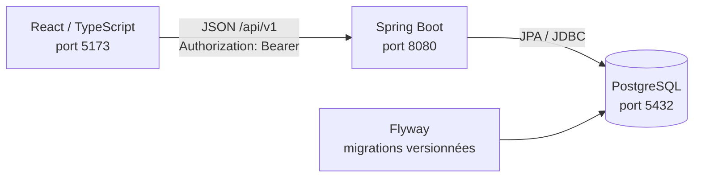

# Architecture

Les dépôts du frontend et du backend restent indépendants. Le navigateur ne se connecte jamais directement à PostgreSQL.

## Paquets Java (`sn.samaadresse`)

| Paquet | Rôle |
|---|---|
| `security` | Chaîne de filtres Spring Security, émission/validation des JWT, clé de signature, conversion jeton → compte. |
| `auth` | Inscription, connexion, compte courant, limitation des tentatives, promotion admin au démarrage. |
| `user` | Entité `UserAccount` et son repository. |
| `address.domain` / `repository` | Entité `Address`, statuts, règles de modération. |
| `address.service` | Consultation publique, création par le propriétaire (génération du code et collisions), modération. |
| `address.web` | Contrôleurs publics, propriétaire (`/me/addresses`) et admin (`/admin/addresses`), DTO dédiés. |
| `common` | Format d'erreur commun (problem+json), pagination. |
| `config` | CORS, OpenAPI. |

## Flux d'une requête authentifiée

1. Le filtre `BearerTokenAuthenticationFilter` lit l'en-tête `Authorization`.
2. `NimbusJwtDecoder` vérifie la signature HS256, l'émetteur et l'expiration.
3. `AccountJwtConverter` recharge le compte en base : absent ou désactivé → 401 ; sinon autorité `ROLE_USER` ou `ROLE_ADMIN`.
4. Les règles d'URL de `SecurityConfig` autorisent ou refusent (403).
5. Le contrôleur récupère l'identifiant du compte via `CurrentUser.id(authentication)` et le service filtre les données par propriétaire.

## Création d'adresse et unicité du code

`OwnerAddressService.create` n'ouvre pas de transaction englobante : chaque tentative d'insertion s'exécute dans sa propre transaction (`REQUIRES_NEW`). Si la contrainte `UNIQUE` de PostgreSQL rejette un code (création concurrente), seule cette tentative est annulée et un autre code est tiré. Ce comportement est vérifié sur un vrai PostgreSQL par `PostgresAddressCodeIntegrationTest` (Testcontainers), avec un générateur volontairement limité à 3 codes pour provoquer des collisions.

Flyway est responsable du schéma ; Hibernate vérifie seulement sa cohérence (`ddl-auto: validate`).
