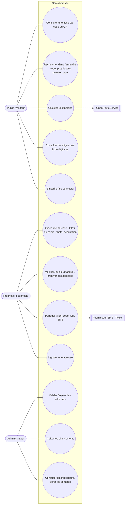
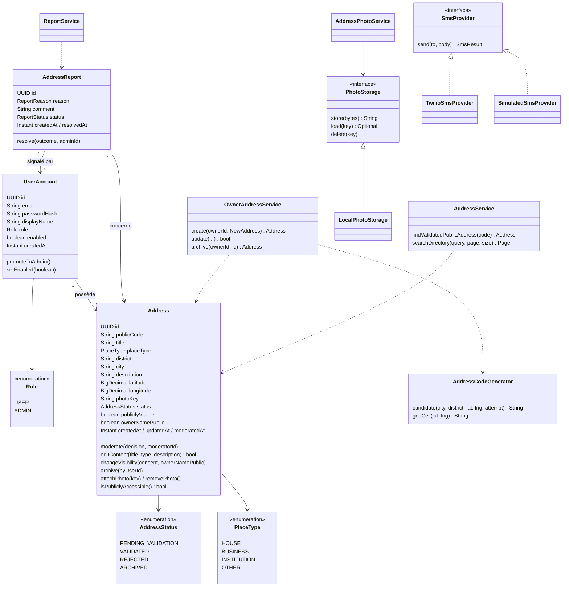
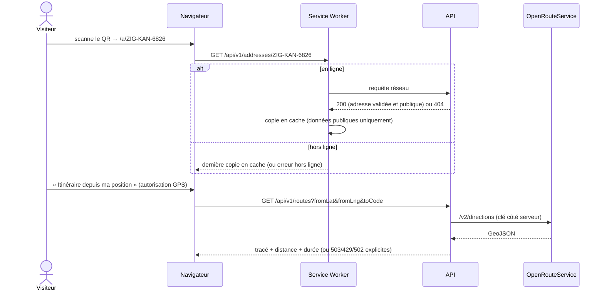
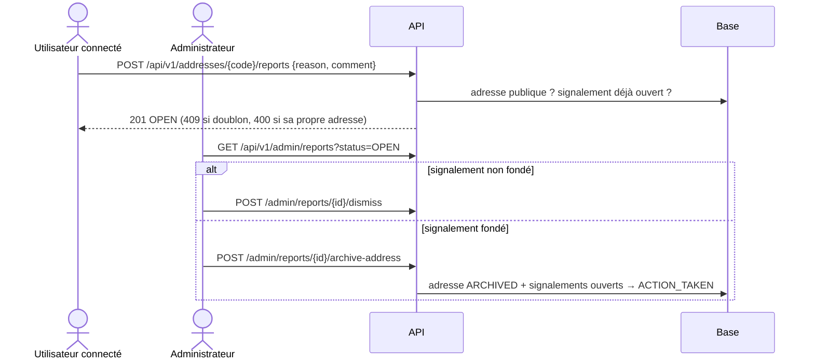

# Diagrammes UML — SamaAdresse

Diagrammes au format [Mermaid](https://mermaid.js.org/) : GitHub les affiche directement ; on peut aussi les exporter en image avec <https://mermaid.live>.

## 1. Cas d'utilisation

Mermaid n'a pas de diagramme de cas d'utilisation natif : les acteurs sont à gauche, les cas d'utilisation (ovales) à droite. Un utilisateur connecté (propriétaire) peut aussi faire tout ce que fait le public ; l'administrateur aussi tout ce que fait un propriétaire.



## 2. Classes (domaine et services principaux)



## 3. Séquence : créer une adresse (GPS, code unique, photo)

```mermaid
sequenceDiagram
    actor P as Propriétaire
    participant N as Navigateur (PWA)
    participant API as API Spring Boot
    participant G as AddressCodeGenerator
    participant DB as PostgreSQL
    participant S as PhotoStorage

    P->>N: « Utiliser ma position » (autorisation)
    N->>N: GPS → lat/lng ; code provisoire VIL-QUA-NNNN calculé localement (hors ligne possible)
    P->>N: informations, photo, consentement
    alt connexion indisponible
        N->>N: brouillon local « en attente de synchronisation »
    end
    N->>API: POST /api/v1/me/addresses (JWT)
    API->>API: validation (champs, zone Sénégal)
    loop essai 0, 1, 2… (au plus 100)
        API->>G: candidate(ville, quartier, lat, lng, essai)
        API->>DB: existsByPublicCode ?
        API->>DB: INSERT (transaction dédiée)
        alt contrainte UNIQUE violée (création concurrente)
            DB-->>API: uk_addresses_public_code
        else succès
            DB-->>API: adresse PENDING_VALIDATION
        end
    end
    API-->>N: 201 + code définitif
    N->>API: PUT /me/addresses/{id}/photo (multipart)
    API->>API: signature JPEG/PNG, ≤ 5 Mo, réencodage sans EXIF
    API->>S: store(jpeg)
    API-->>N: 200 hasPhoto=true
```

## 4. Séquence : consulter une fiche publique et l'itinéraire



## 5. Séquence : signalement traité par un administrateur


